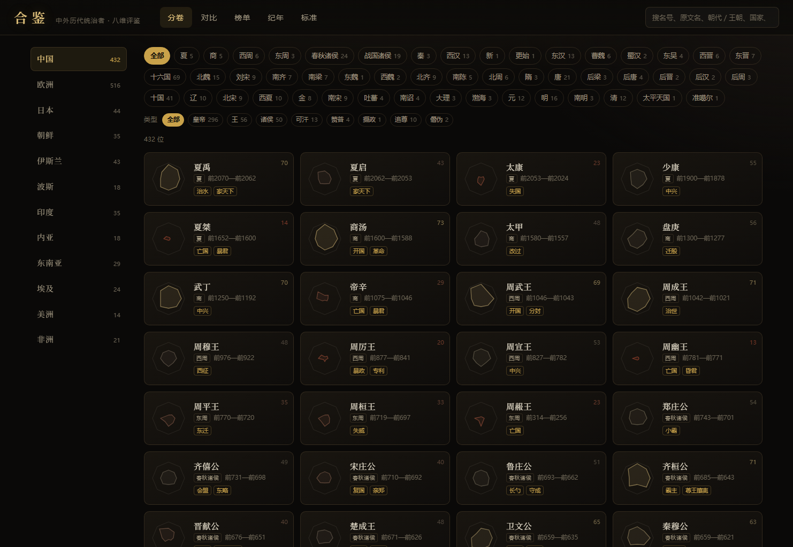
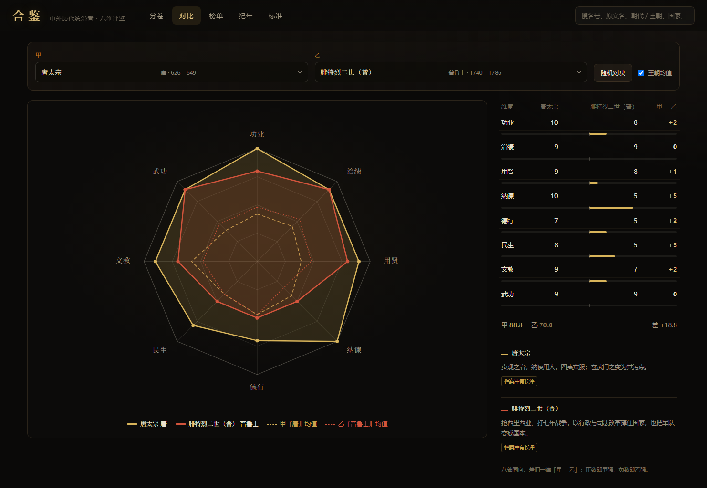
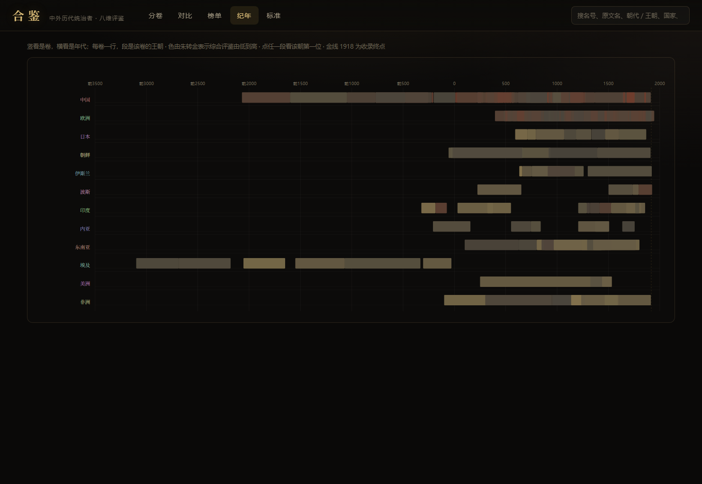

# 合鉴 · 中外历代统治者八维评鉴

把十二个文明的一千二百余位统治者放进同一套坐标：**功业、治绩、用贤、纳谏、德行、民生、文教、武功**，八根轴，每人一张雷达图，任意两人——哪怕隔着文明与四千年——都可以叠在一张图上对看。

最初是《帝鉴》（中国 432 位）与《王鉴》（欧洲 516 位）两站合流；之后又加了日本、朝鲜、伊斯兰、波斯、印度、内亚、东南亚、埃及、美洲、非洲十个文明。八根轴在所有文明上同名同向，只在释义上各按本文明改写，所以图能直接叠。

零依赖静态站，双击 `index.html` 即开，不需要服务器、不需要联网。

[**在线访问 → https://Ceresrrr.github.io/hejian/**](https://Ceresrrr.github.io/hejian/)

[](https://github.com/Ceresrrr/hejian/actions/workflows/pages.yml)



---

## 能做什么

| 页签 | 用途 |
| --- | --- |
| **分卷** | 十二卷，一个文明一卷（中国／欧洲／日本／朝鲜／伊斯兰／波斯／印度／内亚／东南亚／埃及／美洲／非洲）→ 旗下王朝 → 类型三层筛选；点卡片看完整档案 |
| **对比** | 任选甲乙两人，叠在同一张雷达图上，附各自所属政权的均值虚线、逐轴差值表、综合分与两人总评；默认是 唐太宗 对 腓特烈二世 |
| **榜单** | 八个分维、综合分、在位年数，**全量排序**（1229 人同榜），点行开档案 |
| **纪年** | 前 3500 年至 1930 年的条带图，**一卷一行**，段是该卷的王朝，颜色深浅表示综合评鉴，点一段开该朝第一位 |
| **标准** | 打分口径、十二文明双例锚点表、收录范围、去重规则、可信度与作品自认的边界 |

另有全站搜索（名号／原文名／朝代或王朝／国家／标签／评语），以及 **随机对决** 按钮。




---

## 数据规模

- **1229 位**统治者，**176 个王朝／政权**，**12 卷**，**12 个文明**
- 中国 432 · 欧洲 516 · 日本 44 · 朝鲜 35 · 伊斯兰 43 · 波斯 18 · 印度 35 · 内亚 18 · 东南亚 29 · 埃及 24 · 美洲 14 · 非洲 21
- 中国卷上起先秦，下讫清；欧洲上起 395 年东西分治，下讫 1918 年诸帝国崩溃；埃及上起前 3100 年早王朝；美洲上起玛雅古典期，下讫 1533 年印加覆亡
- 每位：八维评分 + 一句总评 + 标签；其中 84 位另有长评（170—260 字，写清在位年、关键事件与代价）
- 可信度三档：高 788 · 中 398 · 存疑 43 —— 存疑几乎全在埃及、美洲、非洲与内亚，旁证文明一律压低解析度，不拿它去拉高或拉低排名
- 摘句 33 条，全部来自中国卷；其余各卷此栏留白 `-`——只收能逐字核对到具名中译本的句子，一时核对不到的不编

各卷人数：

```
中国   432 · 欧洲   516 · 日本    44 · 朝鲜    35
伊斯兰  43 · 波斯    18 · 印度    35 · 内亚    18
东南亚  29 · 埃及    24 · 美洲    14 · 非洲    21
```

## 分数怎么算

八维各 0—10 整数。**八根轴全部同向：数值越高越好**，雷达面积就是「人望」。其中功业、治绩、民生、文教、武功说的是「事情办得怎么样」，用贤、纳谏、德行说的是「这个人坐在位子上是什么样子」。

综合分只用于排序与上色：

```
综合 = 50 + 10 × (八维均值 − 5)      // 0—100，50 为平庸之主
```

把一个人压成一个数必然失真，所以综合分从不单独出现，永远跟着八维和总评。

## 一人只收一次

君位是叠的：同一个人可能兼着两个王冠，也可能在中国被追尊、在欧洲被算作选帝侯的傀儡。统一按「只收一处、余处作注」处理：

- 查理五世归神圣罗马卷，腓力二世以下归西班牙卷
- 詹姆斯六世兼英格兰，归英伦卷（作詹姆斯一世）
- 丹麦王兼挪威、瑞典者归丹麦卷；玛格丽特一世只收丹麦一行
- 阿方索五世兼那不勒斯，归阿拉贡卷
- 哈布斯堡的奥地利与神圣罗马同君，归神圣罗马卷；1804 年后的奥地利皇帝单列
- 中国追尊者（如曹操、司马懿）归其政权卷，标「追尊」；僭伪、幼主单列
- 日本天皇与武家两系并立，同一人跨阶段（源赖朝、德川家康）按阶段分记，名号相同而年份不重叠
- 内亚的蒙古诸汗、印度的莫卧儿、美洲与非洲的君主，各只在其本卷出现一次
- 1912、1918 年仍在位者按史实记完整在位年，纪年条到收录终点截断

## 数据从哪来

前十六卷由两个独立项目只读合并而来，后二十七卷按同一格式新写：

```
../dijian/data   ─┐
                  ├─→ data/{volumes,regimes,rulers}*.tsv ─→ js/data.js
../wangjian/data ─┘
        tools/plan-expansion.mjs  ─→ 43 卷 / 176 政权的历史骨架（现并成 12 卷）
```

- `tools-merge.mjs` 只读 `../dijian` 与 `../wangjian`，两个源项目一个字不改；十二个文明各并成一卷（`cn`、`eu`、`jp`、`kr`、`is`、`ps`、`in`、`st`、`se`、`eg`、`am`、`af`）
- `tools/plan-expansion.mjs` 定义新增的 27 卷与 65 个政权（`j1`—`j4`、`k1`—`k3`、`i1`—`i4`、`p1`—`p2`、`d1`—`d4`、`s1`—`s2`、`t1`—`t2`、`g1`—`g3`、`m1`、`f1`—`f2`）
- 人物行 13 列统一，`data/rulers/` 下一个小文件一卷，便于回溯
- 欧洲的 `kind: wang`（国王）在合并时映射为 `king`，与中国的 `wang`（王）区分；新增 `caliph／sultan／shah／pharaoh／tenno／maharaja／raja／negus／shogun／ajaw／chanyu／mansa／tlatoani／inca` 等共 27 种类型

## 文件

```
hejian/
├─ index.html            单页外壳
├─ css/style.css         史鉴风样式（墨黑 · 竹简金 · 朱砂）
├─ js/core.js            纯计算：维度、类型、几何、筛选、排序、校验（Node 可直接 require）
├─ js/data.js            自动生成的数据包（勿手改）
├─ js/ui.js              渲染与交互（文明分组、动态配色、卷为行的纪年、跨文明对比）
├─ data/
│  ├─ volumes.tsv        12 卷（一个文明一卷，含 civil 列）
│  ├─ regimes.tsv        176 个王朝／政权：代码、名称、所属卷、起止年
│  └─ rulers/*.tsv       人物数据，按卷分文件
├─ tools-merge.mjs       从 ../dijian 与 ../wangjian 只读合并（首次或重同步时跑）
├─ tools/plan-expansion.mjs  新增文明与政权的规划表（重跑会补齐缺失的卷与政权）
├─ build-data.mjs        TSV → js/data.js
├─ check-rows.mjs        校验待并入的 TSV 行（列数、政权码、类型、分数、重名、年份）
├─ pack.mjs              生成 dist/：只含上线需要的文件
├─ .github/workflows/pages.yml  push 到 main 即构建、跑测试、发布 GitHub Pages
├─ package.json           npm run build / test / pack / site 等脚本
├─ LICENSE                MIT（代码）+ CC BY 4.0（文字与评分）
├─ deploy.md             发布到公网（买域名、托管、备案）的完整步骤
├─ 404.html              错误页
├─ favicon.svg           站点图标
├─ robots.txt / sitemap.xml  抓取、站点地图
├─ _headers              缓存头（Cloudflare Pages 用，GitHub Pages 会忽略）
├─ tools/set-site.mjs     一条命令把占位符换成真实账号与仓库名
├─ test.mjs              自检（数据完整性 + 核心函数 + 页面挂载点）
├─ preview.mjs           终端预览：概览 / 单人 / 对比
├─ shots.mjs             CDP 截图到 preview/
└─ preview/              截图
```

## 改数据

人物用制表符分栏，一行一人，`-` 表示空：

```
政权代码 ⇥ 名号 ⇥ 原文名 ⇥ 起年 ⇥ 止年 ⇥ 类型 ⇥ "8个逗号分" ⇥ 标签 ⇥ 总评 ⇥ [长评] ⇥ [摘句] ⇥ [出处] ⇥ [可信度]
```

年份用公元正数，公元前写负数（如 `-221`）。改完跑：

```bash
node build-data.mjs   # 重新生成 js/data.js（会校验列数、政权代码、分数范围）
node test.mjs         # 两万八千条断言
node preview.mjs      # 终端看概览
node preview.mjs 唐太宗
node preview.mjs 唐太宗 "腓特烈二世@普鲁士"   # 重名加 @ 指定政权
```

若两站数据更新，重跑 `node tools-merge.mjs` 再 `node build-data.mjs`；新增文明只想补骨架，重跑 `node tools/plan-expansion.mjs`（只补缺失的卷与政权，不覆盖人物）。

## 发布到 GitHub Pages

仓库里已经配好 `.github/workflows/pages.yml`：推到 `main`，GitHub 就自动构建数据、跑完两万八千条断言、把 `dist/` 发布成网站。

```bash
# 1. 把占位符换成你的账号（仓库名默认 hejian，可加第二个参数改）
node tools/set-site.mjs <你的GitHub账号>

# 2. 推到 GitHub
git init -b main
git add .
git commit -m "合鉴：十二文明 1229 位统治者"
git remote add origin https://github.com/<你的GitHub账号>/hejian.git
git push -u origin main
```

3. 打开仓库 **Settings → Pages**，把 **Source** 选为 **GitHub Actions**。

等第一次 Action 跑完（约 1 分钟），站点就在：

```
https://<你的GitHub账号>.github.io/hejian/
```

本地想先看线上产物：

```bash
node build-data.mjs && node test.mjs && node pack.mjs
npx serve dist          # 或者直接把 dist/index.html 拖进浏览器
```

想绑自己的 `.com` 域名、或改投 Cloudflare Pages / Vercel / 阿里云 OSS，见 **[deploy.md](deploy.md)**。

## 边界

- **分数是判断，不是史实。** 史料多少、历代评价、作者取舍都在里面；本作能做的是把口径写在「标准」页，让不同意见有据可吵。
- **十二个文明的政治形式不同，同一个词要分开理解。** 中国的「纳谏」是对谏官、台谏与言路的容受；欧洲是对等级会议、议会与请愿的容受；伊斯兰是对舒拉、迪万与乌里玛的容受。轴同名，读法随制度走，标准页逐轴写清。
- **材料极不均。** 拜占庭有普罗科匹厄斯与塞奥法尼斯的编年，早期法兰克只有一部《法兰克人史》，北欧萨迦掺着传说；埃及靠铭文与纸草，美洲靠抄本与西班牙记述，非洲靠铭文、阿拉伯游记与口传。材料少的分数趋中，并在档案里标「史料稀薄」，不做过度解读。
- **幼帝与傀儡。** 在位数月、未及亲政者，其「功业」「治绩」不是零，而是无从谈起；本作仍给低分，但在总评里写清。
- **时代标准。** 以近代早期国家的治理能力为尺，不以现代民主或人权尺度倒推。
- 收录止于各文明旧秩序的终点（中国 1912、欧洲 1918、奥斯曼 1922、日本 1868 等）；之后即位的君主不收。

## 许可

- **代码**（`js/core.js`、`js/ui.js`、构建与校验脚本）：MIT，见 [LICENSE](LICENSE)
- **文字与评分**（`data/`、`js/data.js` 里的评语、长评、标签）：CC BY 4.0，引用时注明「合鉴」并附本站链接即可
- 分数是有立场的历史判断：欢迎引用，也欢迎不同意。
